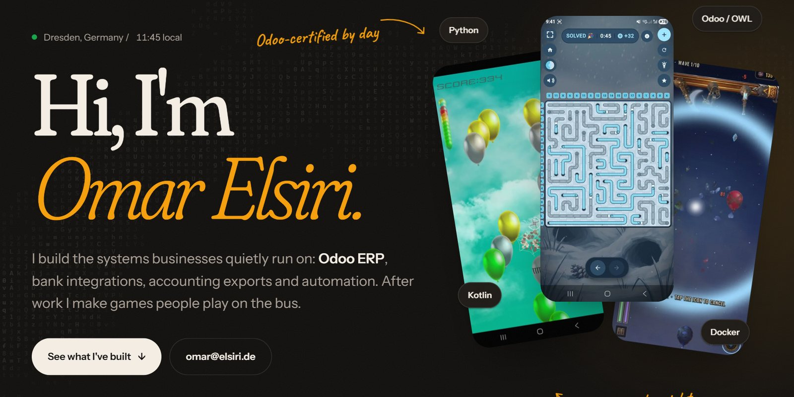

### Hi, I'm Omar.

I'm an Odoo-certified developer at **Paligo GmbH** in Dresden. Most of what I build sits where Odoo meets money: bank sync, accounting exports, the modules a business needs that the standard app doesn't cover. After work I make Android games.

I started out assembling and testing electronics in Egypt, taught myself Android, and ended up in German ERP. The hardware years still shape how I debug.

**[elsiri.de](https://elsiri.de)** · **[omar@elsiri.de](mailto:omar@elsiri.de)** · **[Google Play](https://play.google.com/store/apps/developer?id=Omar+Elsiri)**

---

#### What I do for a living

- **Banking APIs in Odoo.** Revolut, FinAPI and Tink: automatic bank sync, transaction matching and payments across several providers.
- **DATEV interface.** A custom Odoo module that hands bookkeeping data to DATEV in the shape German accountants expect.
- **Custom Odoo modules.** OWL components, QWeb reports, XML views and automated workflows.
- **AI and automation.** LLM pipelines, local models and scraping jobs that feed straight into the workflow.
- **Servers.** Linux, Docker, Nginx, DNS and TLS. I run my own stack too, so I know what breaks at 3 a.m.

#### Things I've shipped

<table>
  <tr>
    <td width="50%" valign="top">
      
       <b><a href="https://slither-hole.elsiri.de">Slither Hole</a></b> 
      A logic puzzle for Android. Pull each snake out of its burrow until every row and column adds up.
    </td>
    <td width="50%" valign="top">
      
       <b><a href="https://fight-balloons.elsiri.de">Fight Balloons</a></b> 
      An arcade balloon shooter. Skulls, black holes, armoured balloons.
    </td>
  </tr>
  <tr>
    <td width="50%" valign="top">
      
       <b><a href="https://trustme.elsiri.de">Trust Me</a></b> 
      A precision platformer where the level is lying to you. 400 levels.
    </td>
    <td width="50%" valign="top">
      <a href="https://chromewebstore.google.com/detail/odoo-auto-debug/fdmmgdboacomicidlheikhmhilabepjh"><b>Odoo Auto Debug</b></a> 
      My Chrome extension. It remembers debug mode per Odoo site and puts custom fields one click away.
        
      <b>Balloons Revenge</b> <i>(in development)</i> 
      An online roguelite tower defense where the threat rises from below.
    </td>
  </tr>
</table>

#### Built for myself

- **Creator Studio.** An Odoo module that reviews, approves and schedules the narrated videos my PC renders, one post per channel, cut to each platform's limits.
- **Market Assistant.** Odoo searches marketplaces through their APIs on a schedule, and my own AI rules decide which listings are actually worth a look.
- **Toolpath.** Converts Cura G-code for a high-speed extrusion 3D printing test rig, with arc fitting and a per-layer before/after view. Built during my M.Sc.
- **A self-hosted stack.** 30+ services on my own server: Odoo, n8n, Nextcloud, my own mail, Home Assistant, local LLMs and the web server behind elsiri.de.

#### Tools I reach for

          

#### The path here

| When | What | Where |
|---|---|---|
| since 2026 | Odoo-certified developer | Paligo GmbH, Dresden |
| 2024 - 2026 | IT specialist and Odoo developer | Celeritas-8 GmbH, Leipzig |
| ongoing | M.Sc. Advanced Manufacturing Technology | TU Chemnitz |
| 2016 - 2023 | Android developer | self-employed, Egypt |
| 2017 - 2023 | Training supervisor, electromechanical assembly | High Tech, Mansoura |
| 2014 - 2019 | B.Sc. Mechanical and Power Engineering | Mansoura University |

I speak Arabic (native), English (C1) and German (B1).
